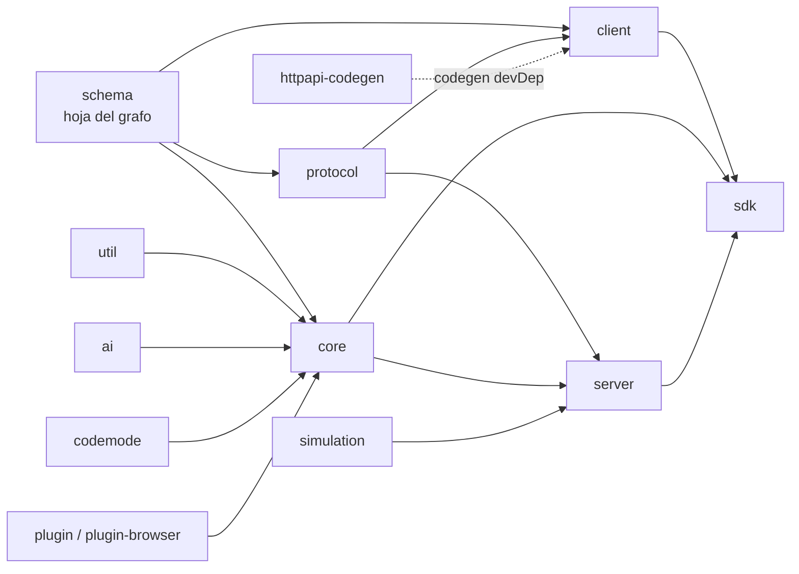

# Arquitectura de opencode (v2)

> Documento verificado contra el código fuente en `2.0.32` @ commit `050fa302b6` (rama `dev`, 2026-10). Cada sección cita las rutas concretas que la respaldan; la metodología de construcción y los comandos de verificación se listan al final.

opencode es una herramienta de desarrollo asistida por IA (agente de coding). La arquitectura v2 es un **monorepo Bun** de ~40 paquetes implementados sobre **Effect 4**, con el dominio central —las sesiones como agregados de *event sourcing*— aislado tras una **API HTTP canónica declarada en Protocol y generada en código** para todos los clientes.

---

## 1. Estructura del monorepo e inventario de paquetes

Workspace **Bun** (`packageManager: bun@1.4.2`, versión `2.0.32`) definido por los globos de `workspaces.packages` en la raíz (`package.json:38-45`):

```
packages/*  packages/plugins/*  services/*  packages/console/*  packages/stats/*
```

Organización por capa (nombres reales de paquete, todos bajo `packages/` salvo donde se indique):

| Capa | Paquetes | Rol |
|---|---|---|
| Fundamentos | `schema`, `util` | `schema`: tipos/esquemas del dominio (hoja del grafo). `util`: telemetry OpenTelemetry, spawn, globs, infra de Effect. |
| Dominio | `protocol`, `core`, `ai`, `codemode` | Contrato HTTP; motor de sesiones/eventos/tools/MCP; proveedores LLM (Vercel AI SDK + credenciales AWS/GCP); sandbox JS con acorn. |
| Transporte/API | `server`, `client`, `httpapi-codegen`, `sdk`, `simulation` | Montaje HTTP+SSE del API canónico; cliente generado (promise/solid/effect); compilador de clientes a partir del `HttpApi`; SDK embebido; simulación/qa. |
| UI | `tui`, `app`, `session-ui`, `gui-extensions`, `ui`, `theme`, `storybook`, `desktop` | TUI OpenTUI/Solid; web app Solid; componentes de sesión compartidos; extensiones UI plugueables; primitivas; temas (tokens semánticos); Storybook para tests de componentes; shell Electron. |
| Extensibilidad / soporte | `plugin`, `plugin-browser`, `latex`, `merman`, `http-recorder`, `posts`, `web`, `function`, `script` | Interfaz y host de plugins; host para contextos navegador; render LaTeX/Mermaid en TUI; grabación HTTP; blog; docs Astro (Starlight); función cloud; scripts internos. |
| Anidados / otros | `plugins/figma`, `console/{app,core,function,mail,resource,support}`, `stats/app`; `sdks/vscode`; `services/{changelog,files,update,www}` | Plugins concretos; apps internas de consola y estadísticas; extensión VS Code; servicios auxiliares cloud. |

Además en la raíz: `infra/` + `sst.config.ts` (despliegue SST), `nix/flake.nix` (entorno de desarrollo reproducible), `script/` (release, lint, ast-grep, generación), `specs/`, `patches/` (dependencias parcheadas).

**Nota — código legado:** `packages/opencode` **no** es un workspace (carece de `package.json`). Contiene la fuente de la generación anterior (`acp/cli/plugin/provider/server/session`) conservada como referencia durante la migración a v2; el último commit que lo tocó es precisamente una migración "plugins to v2" (verificable con `git log -- packages/opencode`).

---

## 2. Dirección de dependencias entre paquetes

Regla de diseño (`AGENTS.md`, sección *Your Model* del repo): *"Keep runtime dependencies directed from Schema to Core and Protocol, then from Core and Protocol to Server. Client runtime code may depend on Schema and Protocol but never Core or Server; `sdk` composes Client, Core, and Server."*

Verificada extrayendo `dependencies` de cada `package.json`: el grafo real coincide **exactamente** con la regla.



Detalles verificados:

- **`@opencode/schema`**: cero dependencias internas (solo `effect` + `@standard-schema/spec`). Es la hoja del grafo y el único lugar donde viven los esquemas de dominio (`packages/schema/src/*`: session, agent, model, prompt, mcp…).
- **`@opencode/protocol`** → `{schema, effect}`.
- **`@opencode/core`** → `{ai, codemode, plugin, plugin-browser, schema, util}` + `drizzle-orm`, client MCP (`@modelcontextprotocol/client|core`), pty, tree-sitter. No depende de Protocol ni de Server.
- **`@opencode/server`** → `{core, protocol, simulation, schema, util}`: compone Core y Protocol hacia arriba.
- **`@opencode/client`** → **solo** `{schema, protocol}`, más `httpapi-codegen` como *devDependency* (codegen). Nunca importa Core ni Server (comentario explícito en `packages/client/src/effect/index.ts`).
- **`@opencode/sdk`** → `{client, core, plugin, schema, server, util}`: la única composición legítima de client+core+server.

---

## 3. Superficie pública: Protocol / HttpApi / codegen / SDK

### 3.1 Protocol posee el contrato canónico

El único dueño del contrato HTTP es `@opencode/protocol`, vía Effect `HttpApi`:

- Tabla de rutas canónica: `packages/protocol/src/api.ts:161` — `HttpApi.make("server")` + todos los grupos + middlewares.
- Grupos de endpoints declarativos (~32 ficheros) en `packages/protocol/src/groups/*.ts`: session, message, permission, location, agent, model, provider, mcp, fs, pty/persistentPty (incl. terminal), shell, credential, integration (oauth/wellknown…), project, worktree, vcs, websearch, plugin, skill, command, form, config, generate.text, voice.session, event, `rpc.call` (`POST /api/rpc/:rpcID/:method`, `groups/rpc.ts:14`), debug.location, migration.v1.status.
- Middlewares declarados por Protocol: `Authorization` y `SchemaErrorMiddleware` (`packages/protocol/src/middleware/{authorization,schema-error}.ts`). Comentario de diseño en `api.ts`: *"Protocol owns middleware placement, while Server injects concrete keys so Core service identities stay downstream."*
- Para codegen del cliente existe una instancia espejo con middlewares solo-identidad: `ClientApi` + mapa nombre-grupo → nombre-cliente (`packages/protocol/src/client.ts`).

### 3.2 Ensamblaje del server

El server **no redeclara rutas**: consume el API y lo monta con capas concretas.

- Consumo del API: `makeDefaultApi({ locationMiddleware, formLocationMiddleware, sessionLocationMiddleware })` en `packages/server/src/api.ts`.
- Montaje: `HttpApiBuilder.layer(Api, { openapiPath: "/openapi.json" })` + `Layer.provide` de handlers, location, authorization y schema-error (`packages/server/src/routes.ts`; variante embebida `createEmbeddedRoutes`).
- Handlers: un único grafo `Layer.mergeAll(ServerHandler, DebugHandler, … SessionHandler, … EventHandler)` en `packages/server/src/handlers.ts`, con un handler por grupo bajo `handlers/<dominio>.ts`.
- Bootstrap/proceso: `ServerProcess.start` + `listen({ hostname, port })` en `packages/server/src/process.ts`.
- **Eventos (SSE)**: endpoint `GET /api/event` declarado como stream SSE en `groups/event.ts`; lo sirve `EventHandler` sobre el servicio `EventFeed` (`packages/server/src/handlers/event.ts`, headers SSE + heartbeat 15 s). Mecánica de fan-out en `packages/server/src/event-feed.ts`: framing `data: {json}\n\n` y colas por suscriptor `Queue.dropping(4096)` — el stream es **volátil por contrato**: un consumidor lento recibe `SubscriberOverflowError` y su stream falla.
- **Auth**: password Basic opcional + cookie de sesión HMAC firmada con TTL de 30 días (`opencode_session_<port>`), verificada en `packages/server/src/auth.ts`.

### 3.3 Codegen del cliente (`bun run generate`)

El input de la generación **no es un documento OpenAPI, es el propio objeto `HttpApi`**:

- Script: `packages/client/script/build.ts` — importa `ClientApi`, `groupNames` y listas de omisión desde `@opencode/protocol/client` y ejecuta (líneas 45-46):
  ```ts
  const promiseContract = compile(ClientApi, { groupNames, omitEndpoints: promiseOmitEndpoints })
  const effectContract  = compile(ClientApi, { groupNames, omitEndpoints: effectOmitEndpoints })
  ```
  El compilador es `@opencode/httpapi-codegen` (`packages/httpapi-codegen/src/index.ts`), que refleja el API con `HttpApi.reflect(api)` y normaliza params/query/headers/payload/success/errors por endpoint. Omisiones conocidas: `pty.connect`, `persistentPty.connect` (promise) y además `fs.read/fs.write` en la variante Effect (`packages/protocol/src/client.ts`).
- Salidas (tres escrituras, cada una con manifiesto `.httpapi-codegen.json`): `src/promise/generated` (client ~2300 líneas + types ~6900), `src/effect/generated`, y `src/effect/api` (formas Input/Output). Encabezado en los archivos: *"Generated by @opencode/httpapi-codegen. Do not edit."*
- Capas manuales **por encima** del código generado, una por estilo de consumo — promise (`promise/{client,service,rpc}.ts`), solid (estado reactivo sobre la conexión: `solid/{connection,data,pty,usage,index}.ts`) y effect (`effect/client.ts`, inyecta `HttpClient`, headers RPC y re-expone `event.subscribe` como stream compartido). Export map público en `packages/client/package.json`: `.`, `./promise`, `./promise/api`, `./service`, `./solid`, `./effect`, `./effect/api`, `./effect/service`.
- **Guard de deriva**: el script `check:generated` regenera y exige `git diff --exit-code` sobre los tres destinos. Regla del repo: nunca editar a mano archivos generados; tras cambiar la superficie pública o el HttpApi del server, correr `bun run generate` desde `packages/client`.

### 3.4 SDK embebido (`@opencode/sdk`)

El SDK compone client + core + server tras una frontera de red real dentro del proceso:

- `OpenCode.create(...)` en `packages/sdk/src/opencode.ts` / `sdk/src/promise.ts`: crea un **host embebido** que monta las rutas reales del server (`createEmbeddedRoutes` de `@opencode/server/routes`) con SQLite en memoria, lanza el recovery de sesiones suspendidas (`SessionRestart.resumeSuspendedSessions`) y expone también servicios Core directos; luego construye un cliente normal que habla contra ese host a través de una boundary `fetch` en `baseUrl: "http://opencode.local"` (implementación del host en `packages/sdk/src/internal/host.ts`).
- Resultado: las variantes promise/effect/solid del SDK comparten exactamente la misma superficie HTTP que el servidor remoto — no hay API paralela.

---

## 4. Session Core: event sourcing sobre SQLite

El dominio es un agregado por sesión (`sessionID`) cuyo estado se deriva de un log de eventos durables en SQLite (Drizzle).

### 4.1 Eventos durables

Definidos con `Event.durable({ aggregate: "sessionID", version })` en **`packages/schema/src/session-event.ts`** (re-exportado por Core desde `core/src/session/event.ts`). Familias observadas, con líneas de referencia:

| Familia | Tipos representativos |
|---|---|
| Ciclo de vida | `session.created`(49), `agent.selected`, `model.selected`, `moved`, `renamed`, `metadata.updated`, `permissions`, `viewed`, `deleted`(178), `forked`(188) |
| Inbox | `inbox.enqueued`(216), `inbox.delivered`(209), `inbox.cancelled`(226), `inbox.delivery.changed`(233) |
| Ejecución | `execution.started / succeeded / failed / interrupted` (ns `Execution`, 239-254) |
| Paso/modelo | `step.started/streamed/ended/failed`(330-373), `text.*`(393-416), `reasoning.*`(431-455), `tool.input.*/called/progress/success/failed`(477-552), `retry.scheduled`(570) |
| Contenido | `message.content.updated`(144), `usage.recorded/updated`(156/168), `instructions.updated`, `synthetic`, `skill.activated`, `shell.started/ended` |
| Compaction / revert | `compaction.started/delta/ended/failed`(584-624), `revert.staged/cleared/committed`(640-646) |

### 4.2 Commit atómico: Bus + proyectores

El log es el servicio **`Bus`** (`packages/core/src/bus.ts`). Cada evento durable se commita en **una sola transacción SQLite**:

1. Lock por agregado (`durableLocks.withLock(aggregateID)`);
2. Asignación de `seq` a partir de la tabla `event_sequence`;
3. Ejecución de los **proyectores registrados** para ese tipo *dentro* de la transacción (comentario clave en `bus.ts:96`: *"Local operational projection committed atomically with a new durable event"*);
4. Escritura del log en las tablas `event(id, aggregate_id, seq, created, type, data-json)` e `event_sequence(aggregate_id, seq, owner_id)` (`packages/core/src/event/sql.ts`, índice único `(aggregate_id, seq)`).

El Bus expone además `replay(...)` y seguimiento por agregado con marcadores de sincronización (usados p. ej. por la superficie `session.log`).

### 4.3 Read-models e inbox solo-pendiente

Los read-models son tablas Drizzle (`packages/core/src/session/sql.ts`) actualizadas por proyectores, no un fold en memoria del log completo:

- **`session_v2`**: estado colapsado de la sesión (incluye `location`, claim de ejecución).
- **`session_message`**: historial visible; se re-deriva ordenando por `seq >= último compaction completed` (`core/src/session/history.ts`).
- **`session_inbox`** (línea 126): guarda **solo trabajo no consumido** — tipo (user | synthetic | compaction | move), payload, modo de entrega (`steer` | `queue`) y `enqueued_seq`. El comentario en el código lo resume: *"the deleted row is what makes the table pending-only"*.

### 4.4 Flujo del prompt (admisión → wake → entrega)

1. `Session.prompt(...)` (facaade en `core/src/session.ts`; implementación `core/src/session/session.ts`) reconcilia idempotencia (*first admission wins* por Session+tipo; reutilizar IDs ajenos falla), prepara el item vía plugins/attachments (`session/prompt.ts`) y **admite**:
2. publica **`session.inbox.enqueued`**; su proyección inserta exactamente una fila pending en `session_inbox` (`onConflictDoNothing`) en la misma transacción;
3. a continuación, salvo `resume: false`, agenda el wake asesorio: `execution.wake(sessionID)`.
4. La **entrega** publica **`session.inbox.delivered`**: su proyección hace `DELETE … .returning()` de la fila inbox e inserta el mensaje visible en `session_message` — ambas operaciones en la misma transacción del commit del evento.
5. Mutaciones pendientes (cancelar / cambiar modo de entrega) publican `inbox.cancelled` / `inbox.delivery.changed`, proyectadas sobre la tabla pending.

Semántica de delivery (`AGENTS.md`): los prompts **stean** por defecto; en límites seguros de paso, la compactación steered tiene prioridad hasta el primer control *move* steered; en límite inactivo se priorizan steers; si no, exactamente un item de cola entrega antes de reevaluar.

### 4.5 Ejecución, recovery y runner

- **`SessionExecution`** (`core/src/session/execution.ts`): proceso-global y dirigido por **Session ID** (no recibe objetos Session). Resuelve placement solo cuando arranca el drain: `LocationServiceMap.get(session.location)` (`core/src/location-service-map.ts`; omitir `Location.workspaceID` = colocación local implícita; workspace explícito reservado para futuras semánticas de placement).
- **Coalescing**: la cola viva es un *doorbell* en `SessionRunCoordinator` (`run-coordinator.ts`) — serializa wakes por sesión y permite sesiones distintas concurrentes. El loop drena hasta que el doorbell queda silencioso; `Moved/Reloaded/Complete` del drain se mapean a re-drain.
- **Recovery write-ahead**: al commit de `execution.started`, un hook fija el claim (`session_v2.time_suspended`) para la ventana de ocupación proceso-local. Terminales (completado/fallo/interrupción) lo liberan; shutdown y muerte de proceso lo conservan. Al arrancar, **`SessionRestart.resumeSuspendedSessions`** (`core/src/session/execution/restart.ts`) reanuda las sesiones suspendidas con contabilidad durable por intento (máx. 10). El claim es un marcador de recovery, no ownership clusterizado ni exactly-once.
- **Runner** (`core/src/session/runner/index.ts`, bucle en `runner/llm.ts`): elige el próximo item promotable del inbox (`SessionInbox.nextPromotable`), gestiona compaction/move y itera pasos — **un paso es una llamada explícita a `llm.stream`** (`core/src/session/runner/step.ts:107`: *"Read to the end, not just the finish event, so the next request can reuse this response."*), rodeada por los eventos durables `step.started/ended`; no existe tool-loop en memoria (las herramientas corren como fibers dentro del mismo intento). Los drains locales son proceso-locales hasta que se implemente clústerización.

---

## 5. Capas de usuario

| Superficie | Paquete | Stack y relación con core/server |
|---|---|---|
| **CLI / binario `opencode`** | `packages/cli` (entry `src/index.ts`, script raíz `dev`) | Arranca un **server local embebido** (`server-process.ts`, `run/`, comandos en `commands/`, soporte ACP en `acp/`) y monta la TUI sobre él. Depende de server + tui + client + plugin: es el único proceso que puede tocar Server directamente junto con el SDK. |
| **TUI** | `packages/tui` | App **SolidJS sobre OpenTUI** (`@opentui/core`, `@opentui/keymap`, `@opentui/solid` — 0.5.17 fijado por el catálogo de la raíz). Estructura: `src/{app.tsx, component/, routes/, feature-plugins/, plugin/, theme/, ui/}`. Las *stories* de sistema (estado fixture-driven del componente real) viven en `feature-plugins/system/storybook` y se prueban con `OPENCODE_STORY=<id> bun run dev:live`. Consume el cliente generado; depende también de core por ser proceso local. |
| **Web app** | `packages/app` (script `dev:web`) | Solid + router + TanStack query; depende **solo** de `client`, `session-ui`, `gui-extensions`, `ui`, `schema`, `util`: es un consumidor HTTP+SSE puro del contrato público, sin Core ni Server. Los componentes compartidos de sesión (markdown/shiki/diffs/streaming) están en `packages/session-ui`; extensiones UI plugueables (documentos ofimáticos renderizados, terminal ghostty-web…) en `packages/gui-extensions` — también client-only. |
| **Desktop** | `packages/desktop` (script `dev:desktop`) | Shell **Electron** construido con electron-vite + electron-builder (`src/{main,preload,renderer,shared}`, configs `electron.vite.config.ts`, `electron-builder.config.ts`). Sus dependencias runtime son solo electron-*: envuelve los assets de la app web. |

Tokens de tema por rol semántico (no por color) con esquema extensible del tema — ver sección *TUI Theme Tokens* de `AGENTS.md` y `packages/theme`.

---

## 6. Extensibilidad: plugins, tools/agents/skills, MCP

- **Plugins** (`@opencode/plugin`, `packages/plugin/src`): interfaz y host con variantes por runtime — `source.{bun,node,package}.ts`, `runtime.ts`, `host.ts`, APIs por estilo (`promise/`, `effect/`), soporte TUI (`tui/`). Los carga el Core (`core/src/plugin.ts` + `core/src/plugin/`) y `plugin-browser` expone el host a contextos de navegador (gui-extensions/web). Plugins concretos son workspaces anidados (p. ej. `packages/plugins/figma`).
- **Tools**: `core/src/tool/` + `tool.ts`. Se ejecutan como fibers dentro del intento de paso (sin tool-loop en memoria); su configuración pública se expone vía el API.
- **Agentes / skills / commands**: definidos y resueltos en Core — `core/src/{agent.ts, skill/, command.ts}`; sus superficies de configuración son grupos del Protocol (`agent`, `model`, `skill`, `command`), con scoping por *Location* (directorio + workspace opcional) a través de la capa de servicios instanciada (`core/src/instance/*`).
- **MCP**: integración con el cliente oficial en `packages/core/src/mcp/{client.ts:28, stdio.ts:3, oauth.ts:17}` (transporte stdio + OAuth); expuesto como recurso `mcp` del API (list/add/remove/connect/disconnect/resource).

---

## 7. Build, checks y tests

- **Turbo** (`turbo.json`, v2.10.2): tareas `typecheck`, `test`, `build` con orden explícito — `@opencode/core#typecheck` es pre-requisito de cli/sdk/server/simulation/tui; la tarea `transit` pliega las dependencias workspace al hash de los tests (los paquetes exportan sus fuentes, así que los tests nunca esperan el build de una dependencia) y **cada paquete con script `test` corre en CI** ("a new suite cannot be left out of CI").
- **Check** (`bun run check` desde la raíz) = lint + typecheck: `oxlint` (con plugins) + **reglas propias de ast-grep para patrones Effect** (`script/ast-grep/**`, con tests de reglas vía `test:lint-rules`) + `turbo typecheck --concurrency=3`.
- **Tests por paquete**: prohibidos desde la raíz — el script `test` de la raíz es un guard que termina 1 con *"do not run tests from root"*; se corren dentro del paquete (p. ej. `bun test` en `packages/core`, timeouts de 5 s).
- **Guard de codegen**: `@opencode/client#check:generated` (regenerar + `git diff --exit-code`).
- **Versiones compartidas**: el catálogo de workspaces de la raíz fija `effect 4.0.1`, OpenTUI `0.5.17`, Solid `1.9.15`, drizzle RC, Vite, etc.; `overrides` y `patches/` (patchedDependencies) mantienen consistencia global. Husky en `prepare`.

---

## 8. Transversal: infraestructura y servicios

- **Nix** (`flake.nix` / `nix/`): entorno de desarrollo reproducible.
- **SST** (`infra/{app,console,share,stage,stats,webapp}.ts`, `sst.config.ts`): despliegue cloud; `services/{changelog,files,update,www}` son servicios auxiliares pequeños (Astro/Jose) y `packages/console/*` + `packages/stats/app` son apps internas.
- **Docs**: docs Astro/Starlight en `packages/web`, blog en `packages/posts`; extensión VS Code en `sdks/vscode`.

---

## 9. Mapa rápido de archivos clave

| Pregunta | Dónde mirar |
|---|---|
| ¿Cuál es el contrato HTTP canónico? | `packages/protocol/src/api.ts` (`HttpApi.make("server")`, línea 161) y `packages/protocol/src/groups/*.ts` |
| ¿Qué genera el cliente y cómo se verifica la deriva? | `packages/client/script/build.ts`; guard `check:generated` en `packages/client/package.json` |
| ¿Cómo se monta el server (auth, SSE)? | `packages/server/src/{api.ts,routes.ts,handlers.ts,event-feed.ts,auth.ts,process.ts}` |
| ¿Dónde están los eventos durables de sesión? | `packages/schema/src/session-event.ts` |
| ¿Quién commita evento + proyección atómicamente? | `packages/core/src/bus.ts`; tablas en `core/src/event/sql.ts` |
| ¿Cómo funciona el inbox pending-only? | Tabla `session_inbox` en `core/src/session/sql.ts:126`; flujo en `core/src/session/{inbox.ts,projector.ts}` |
| ¿Ejecución y recovery tras crash? | `core/src/session/execution.ts`, `run-coordinator.ts`, `execution/restart.ts` (claim write-ahead) |
| ¿Un paso = una llamada al modelo? | `packages/core/src/session/runner/step.ts:107` (`llm.stream`) |
| ¿Dónde está la extensión por plugins/MCP? | `packages/plugin/src/*`; `core/src/{plugin.ts,tool/,agent.ts,mcp/}` |
| ¿Orden de builds y tareas CI? | `turbo.json`; scripts en `package.json` raíz |

---

## Apendice: evidencia de verificación

Todo lo anterior se verificó sobre el árbol de trabajo limpio del commit `050fa302b6` (rama `dev`, sincronizada con origin) mediante:

- Parseo programático de todos los `package.json` de workspaces (`packages/*`, `sdks/*`, `services/*`) para construir la matriz de dependencias.
- Lectura completa de `package.json` raíz, `turbo.json`, `packages/client/package.json` y `packages/client/script/build.ts`.
- Búsquedas dirigidas: `HttpApi.make("server")` (protocol), definición de la tabla `session_inbox` (core), importes de `@modelcontextprotocol/client` (core/src/mcp), llamada `llm.stream` del runner.
- Exploración exhaustiva read-only de `packages/{protocol,server,client,sdk,httpapi-codegen}/src` y `packages/core/src/session*` para las secciones 3 y 4.
